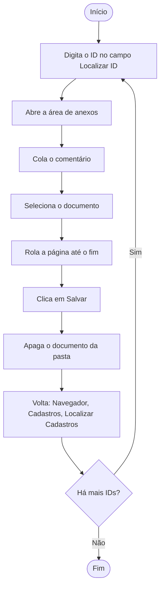

<div align="center">

# 🗂️ Salvamento Automático

**Anexe documentos a dezenas de cadastros sem tocar no mouse.**
Um painel em Python que cadastra os IDs, guarda os pontos de clique e executa o ciclo de anexo por você.


</div>

<!--
  Salve um print do painel em docs/painel.png e troque este comentário inteiro por:
  
-->

---

## ✨ O que ele faz

Para cada ID da lista, o programa repete sozinho o mesmo procedimento: localiza o cadastro, abre a área de anexos, escreve o comentário, anexa o documento, salva e volta para a tela de busca. Você só cadastra os IDs, confere os pontos de clique e aperta **Iniciar**.

- 🧾 **IDs em lotes de 10**, sem limite de lotes. A lista fica sempre em ordem crescente e sem duplicatas.
- 💬 **Comentário único**, editável, usado em todos os registros.
- 🎯 **Cliques por coordenadas** (sem reconhecimento de imagem), capturados pela própria interface.
- 👀 **Botão "Ver"** para conferir onde cada coordenada aponta antes de rodar.
- ✅ **Checklist de segurança** que precisa ser marcado antes de iniciar.
- ♻️ **Retomada de onde parou:** se a execução for interrompida, o painel indica o ID para recomeçar.
- 💾 **Tudo salvo em JSON** local, e um **log** de cada execução.
- 🔌 **Portátil:** os caminhos são relativos, então funciona de pendrive, mesmo que a letra da unidade mude.

---

## 🔄 Como funciona o ciclo



O comentário é colado com `Ctrl+V` (via `pyperclip`) para evitar problemas com acentuação. O ID, por ser só número, é digitado normalmente.

---

## 🖥️ O painel

| Aba | Para que serve |
| --- | --- |
| **IDs** | Cadastra IDs em lotes de 10, mostra a lista salva e define o comentário único. |
| **Coordenadas** | Captura ou digita os 12 pontos de clique. *Capturar* esconde a janela e espera 5 s; *Ver* mostra onde o ponto está. |
| **Executar** | Checklist, pausa entre ações, ID inicial opcional, botão de início e registro da execução. |

<!--


-->

---

## 📋 Requisitos

- Windows
- Python 3 com **Tkinter** (já vem na instalação completa do Python)
- Bibliotecas: `pyautogui` e `pyperclip`

> ⚠️ Versões "embeddable" do Python não incluem o Tkinter. Use uma instalação completa.

---

## 🚀 Instalação

```bash
git clone https://github.com/JoseEdmar/salvar-anexo.git
cd salvar-anexo
python -m pip install -r requirements.txt
```

## ▶️ Como usar

```bash
python painel_salvamento.py
```

Ou dê dois cliques no `iniciar.bat` (veja a seção de Python portátil).

1. **IDs:** digite até 10 IDs, clique em *Adicionar lote à lista* e repita quantas vezes precisar. Ajuste o comentário único.
2. **Coordenadas:** capture cada ponto com o navegador visível e confira com *Ver*.
3. **Executar:** deixe o navegador aberto, logado e na tela *Localizar ID*, com a pasta do documento aberta em tela cheia. Marque o checklist e clique em *Iniciar automação*.

> 💡 Faça o primeiro teste com **1 ID** e a pausa em 5 s. Quando estiver redondo, reduza a pausa aos poucos.

### 🛑 Como interromper

Mova o mouse para o **canto superior esquerdo da tela** (fail-safe do PyAutoGUI). O painel volta e mostra em qual ID parou, para você recomeçar por ele.

---

## ⚙️ Configurações

| Opção | Padrão | Observação |
| --- | --- | --- |
| Pausa entre ações | `5.0` s | Aplicada após cada comando. Reduza para acelerar. |
| Espera inicial | `5` s | Tempo entre confirmar e o primeiro clique (`time.sleep(5)` em `iniciar`). |
| Espera após rolar a página | `2` s | Para o botão Salvar assentar antes do clique. |

> As coordenadas dependem da **resolução, da escala do Windows e da posição das janelas**. Se algo mudar, capture os pontos de novo.

---

## 🗃️ Estrutura

```text
salvar-anexo/
├── painel_salvamento.py   # painel e automação
├── iniciar.bat            # abre o painel com o Python portátil
├── requirements.txt
├── .gitignore
├── README.md
└── dados/                 # criada automaticamente
    ├── dados.json         # IDs, comentário e pausa
    ├── coordenadas.json   # pontos de clique
    └── log.txt            # histórico das execuções
```

A pasta `dados/` guarda IDs e coordenadas da sua máquina, por isso está no `.gitignore`.

---

## 💼 Python portátil (pendrive)

Se o projeto ficar dentro de uma pasta que também contém o Python portátil:

```text
PortableGit/
├── python/python/python.exe
└── salvar-anexo/
```

No VS Code, crie `.vscode/settings.json` com um caminho relativo:

```json
{
    "python.defaultInterpreterPath": "${workspaceFolder}/../python/python/python.exe"
}
```

O `iniciar.bat` usa o mesmo caminho relativo. Se a pasta do projeto ficar um nível mais fundo, acrescente mais um `../` (ou `..\` no `.bat`).

---

## 🧯 Solução de problemas

| Sintoma | O que verificar |
| --- | --- |
| Clica no lugar errado | Recapture as coordenadas e confira com *Ver*. Verifique resolução e escala do Windows. |
| Botão Salvar não é clicado | Capture o ponto com a página **já rolada até o fim**. Aumente a espera após a rolagem se a página demora a carregar. |
| `ModuleNotFoundError` | Instale as dependências com o mesmo Python que executa o painel. |
| `No module named tkinter` | Use uma instalação completa do Python. |
| VS Code usa o Python do PC | Confirme o `settings.json` e o interpretador no canto inferior direito. |

---

## ⚠️ Aviso

A automação controla o mouse e o teclado e **apaga o documento da pasta** ao fim de cada ciclo. Ela não confirma se o sistema salvou o anexo. Teste com poucos registros, acompanhe a primeira execução e use por sua conta e risco.

---